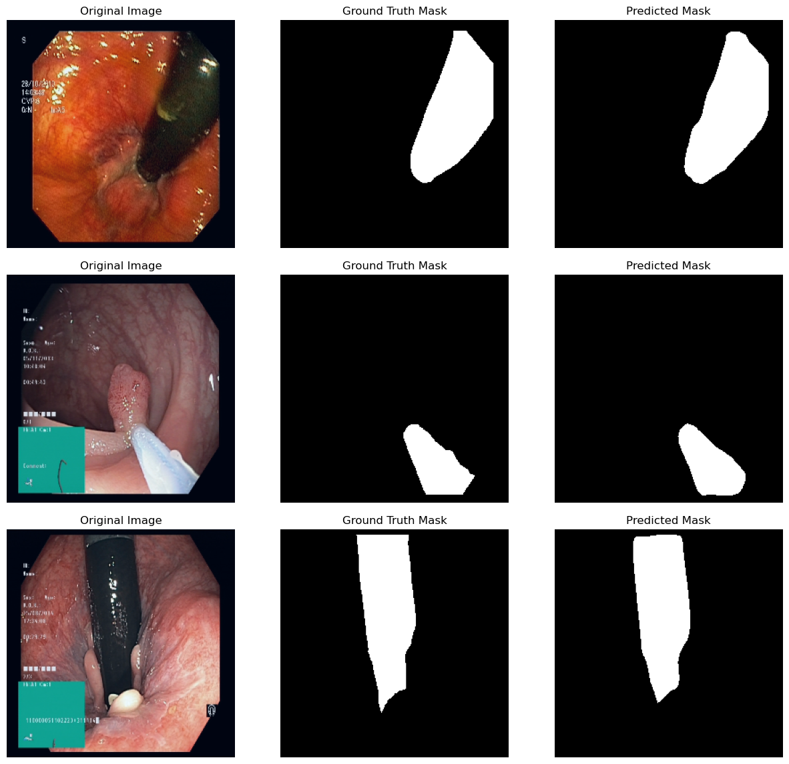
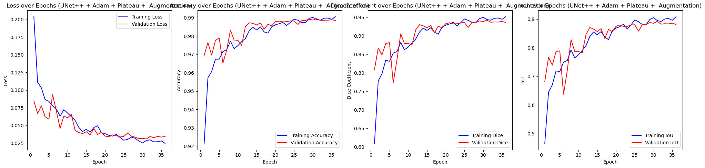

# Surgical Instrument Segmentation in Endoscopy (Kvasir-Instrument)

[](https://github.com/S2k22/Medical-Segmentation-Kvasir-Instrument/actions/workflows/ci.yml)


Pixel-level segmentation of surgical tools in gastrointestinal endoscopy images. I implemented
three encoder–decoder architectures **from scratch in PyTorch** (U-Net, UNet++, and a Feature Pyramid
Network) and compared them across learning rates and data-augmentation settings.

**Best result: UNet++ with a pretrained ResNet34 encoder reached 0.942 Dice / 0.892 IoU on the
held-out test images.**

<p align="center">
  
  <br><em>UNet++ (lr = 1e-3, with augmentation): input image, ground-truth mask and predicted mask</em>
</p>

---

## Highlights

- **Three architectures written by hand.** I didn't use `segmentation_models_pytorch`. Every model is built from basic PyTorch layers:
  - **U-Net**: classic 4-level encoder–decoder with skip connections, trained from scratch (7.8M parameters)
  - **UNet++**: nested, densely connected skip pathways on an ImageNet-pretrained ResNet34 encoder (23.6M)
  - **FPN**: top-down feature pyramid with GroupNorm segmentation heads on ResNet34/50 (23.2M)
- **Reproducible pipeline.** One CLI command downloads the data, trains, evaluates and saves plots, a checkpoint and metrics.
- **Clean training loop.** Adam + `ReduceLROnPlateau`, early stopping, best-checkpoint selection on validation loss, and Dice / IoU / pixel-accuracy metrics computed per image.
- **Augmentation study** with [Albumentations](https://albumentations.ai/): flips, 90° rotations, brightness/contrast and Gaussian noise.
- **Engineering hygiene:** an installable package, unit tests for model shapes, gradients and metrics, Ruff linting, and GitHub Actions CI.

## Dataset

[**Kvasir-Instrument**](https://datasets.simula.no/kvasir-instrument/) (Jha et al., 2021) contains 590
endoscopic images (720×576 up to 1280×1024) of GI procedures with tools such as snares, balloons and biopsy
forceps, plus binary ground-truth masks. The official split is 472 train / 118 test images. All images are
resized to 256×256 and normalized with ImageNet statistics.

The dataset (~170 MB) is downloaded automatically the first time you run training.

## Results

All 9 runs used Adam, `ReduceLROnPlateau` (factor 0.5, patience 2), early stopping (patience 5),
batch size 8, BCE loss and up to 60 epochs. Metrics are for the checkpoint with the lowest validation
loss, evaluated on the 118 official test images.

| Augmentation | LR | Model | Best epoch | Pixel acc. | **Dice** | **IoU** |
|:--|:--|:--|--:|--:|--:|--:|
| ✗ | 1e-1 | FPN | 21 | 0.982 | 0.901 | 0.822 |
| ✗ | 1e-1 | UNet++ | 24 | 0.983 | 0.904 | 0.827 |
| ✗ | 1e-1 | U-Net | 45 | 0.984 | 0.912 | 0.839 |
| ✓ | 1e-2 | FPN | 59 | 0.985 | 0.920 | 0.854 |
| ✓ | 1e-2 | UNet++ | 51 | 0.986 | 0.919 | 0.852 |
| ✓ | 1e-2 | U-Net | 34 | 0.979 | 0.884 | 0.793 |
| ✓ | 1e-3 | FPN | 25 | 0.989 | 0.937 | 0.883 |
| ✓ | 1e-3 | **UNet++** | 31 | **0.990** | **0.942** | **0.892** |
| ✓ | 1e-3 | U-Net | 37 | 0.982 | 0.899 | 0.819 |

Raw numbers: [`results/original_experiments.csv`](results/original_experiments.csv)

<p align="center">
  
  <br><em>Training and validation curves for the best run (UNet++, lr = 1e-3, augmentation)</em>
</p>

### Takeaways

- **Pretrained encoders win once training is tuned.** With augmentation and lr = 1e-3, both ResNet34-based
  models (UNet++ and FPN) beat the from-scratch U-Net by about 4 Dice points. UNet++'s nested skip
  connections gave it a small edge over FPN.
- **The learning rate mattered more than the architecture.** At lr = 0.1 with Adam, the pretrained models
  lost most of their advantage, probably because large updates overwrite the ImageNet features. The
  smaller U-Net trained from scratch was the most robust in that setting.
- **Augmentation together with a lower learning rate** raised the best Dice from 0.912 to 0.942.
- Pixel accuracy is about 98% for every model because most pixels are background. That's why
  **Dice and IoU** are the metrics used to compare models.

> **Methodology note:** In the original experiment notebook, the official test split was also used as
> the validation set for early stopping and LR scheduling. That makes the numbers above slightly
> optimistic. The refactored training code in this repository fixes this: it holds out 10% of the
> training set for validation and touches the test split only once, for the final evaluation.

## Quick start

```bash
git clone https://github.com/S2k22/Medical-Segmentation-Kvasir-Instrument.git
cd Medical-Segmentation-Kvasir-Instrument
pip install -e ".[dev]"          # or: pip install -r requirements.txt

# Train and evaluate all three models (downloads the dataset to ./data on first run)
python scripts/train.py --model all --lr 1e-3

# A single model, without augmentation
python scripts/train.py --model unetpp --lr 1e-3 --no-augment

# Run the tests
pytest
```

Each run writes to `runs/<model>_lr<lr>_<aug|noaug>/`:

| File | Contents |
|:--|:--|
| `best_model.pth` | weights of the checkpoint with the lowest validation loss |
| `history.csv` | per-epoch loss, Dice, IoU and accuracy (train and val) |
| `curves.png` | training curves |
| `predictions.png` | sample test predictions |
| `summary.json` | best epoch and final test metrics |

The device is picked automatically in this order: CUDA, Apple MPS, DirectML (AMD/Intel GPUs on Windows
via `pip install -e ".[directml]"`), then CPU. Run `python scripts/train.py --help` for every option.

## Project structure

```
├── src/kvasir_seg/
│   ├── data.py           # download, train/val/test splits, augmentations, Dataset
│   ├── models/
│   │   ├── unet.py       # U-Net from scratch
│   │   ├── unetpp.py     # UNet++ decoder on ResNet34
│   │   ├── fpn.py        # Feature Pyramid Network on ResNet34/50
│   │   └── encoders.py   # pretrained ResNet feature extractor
│   ├── engine.py         # training/evaluation loop, early stopping, checkpointing
│   ├── metrics.py        # Dice, IoU, pixel accuracy
│   └── viz.py            # training curves and prediction plots
├── scripts/train.py      # CLI entry point
├── tests/                # model shape, gradient and metric tests
├── notebooks/            # original exploratory notebook (outputs cleared)
├── results/              # metrics from the original experiments
└── assets/               # figures used in this README
```

## Architectures

| | U-Net | UNet++ | FPN |
|:--|:--|:--|:--|
| Encoder | 4 × (Conv-BN-ReLU)×2, trained from scratch | ResNet34 (ImageNet) | ResNet34 / ResNet50 (ImageNet) |
| Decoder | Transposed convs + concatenated skips | Nested dense skip nodes, bilinear upsampling | Top-down pathway + lateral 1×1 convs, per-level GN segmentation heads, merged by summation |
| Output | 1×1 conv → logits | 3×3 conv → upsample → logits | 1×1 conv → upsample → logits |
| Params | 7.8M | 23.6M | 23.2M |

The models output logits and are trained with `BCEWithLogitsLoss`, which is numerically more stable than
applying a sigmoid and then `BCELoss`. At inference, a sigmoid and a 0.5 threshold produce the binary mask.

## Possible next steps

- Dice + BCE compound loss and test-time augmentation
- Cross-validation for more reliable comparisons on this small dataset
- Higher input resolution (the masks have fine instrument edges)
- Export to ONNX and a small Gradio demo

## References

- Jha et al., *Kvasir-Instrument: Diagnostic and therapeutic tool segmentation dataset in gastrointestinal endoscopy*, MMM 2021
- Ronneberger et al., *U-Net: Convolutional Networks for Biomedical Image Segmentation*, MICCAI 2015
- Zhou et al., *UNet++: A Nested U-Net Architecture for Medical Image Segmentation*, DLMIA 2018
- Lin et al., *Feature Pyramid Networks for Object Detection*, CVPR 2017

## Author

**Mykhailo Karpiuk**, [GitHub @S2k22](https://github.com/S2k22)

Licensed under the [MIT License](LICENSE).
